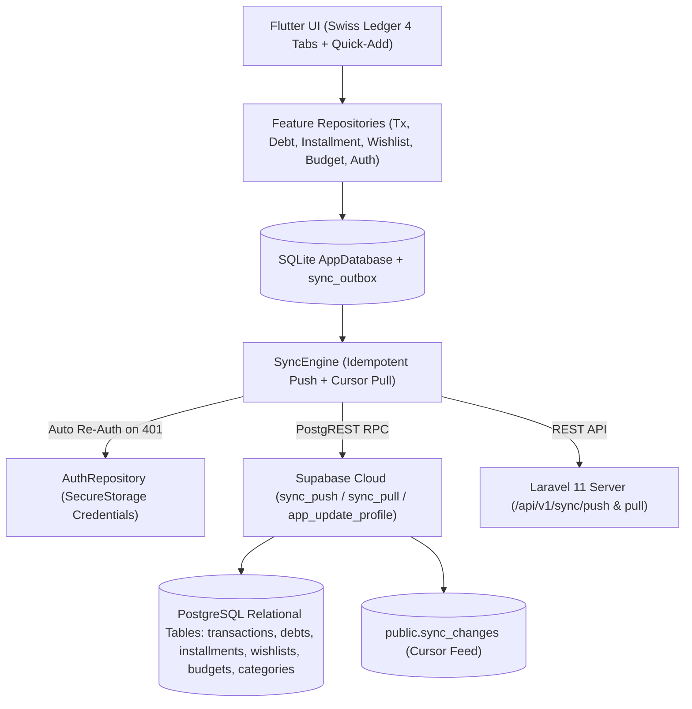

# Product Requirement Document (PRD) & Technical Design — Phase 10: System Hardening, P0 Completion & P1 Financial Intelligence
**Project:** Aplikasi Keuangan Pribadi (Buku Kas Pribadi)  
**Version:** 2.0.0 | **Date:** 2026-11-04 | **Status:** Draft for Builder Review | **Target Platform:** Flutter Android (Offline-First SQLite) + Supabase Cloud (PostgREST RPC) + Laravel 11 API

---

## 1. Executive Summary & Problem Context

- **Latar Belakang:** Aplikasi **Buku Kas Pribadi** telah memiliki fondasi MVP offline-first (SQLite + Sync Outbox), tampilan bergaya *Swiss Ledger*, serta dukungan sinkronisasi awan 24/7 melalui Supabase Cloud (`https://tqzexdhdttkaphalmxbs.supabase.co`) maupun backend Laravel. Berdasarkan audit gabungan **GTPlanner** dan **Impeccable Harden**, ditemukan beberapa celah ketahanan skenario dunia nyata (*edge cases*), detail fitur `P0` PRD yang belum terekspos penuh di UI, serta kebutuhan fitur `P1` untuk pengendalian anggaran (*budgeting*) dan analitik pengeluaran.
- **Persona Pengguna:** Anzhel (`anzhel`), Wina (`wina`), serta pengguna mandiri lainnya yang membutuhkan pencatatan keuangan harian cepat di ponsel Android dengan sinkronisasi lintas perangkat yang tahan gangguan jaringan.
- **Nilai Utama (*Value Proposition*):** Menjamin integritas data 100% di semua tabel relasional (lokal maupun Supabase Cloud), melengkapi transparansi riwayat pembayaran kewajiban/cicilan, serta memberikan kendali anggaran bulanan per kategori (`FR-20`) dan analitik komposisi kas (`FR-22`, `FR-24`) tanpa mengorbankan kecepatan dan kesederhanaan antarmuka *Swiss Ledger*.

---

## 2. Scope & Boundaries

### In-Scope (Wajib pada Fase 10)
1. **MOD-01 — Supabase Relational Sync Hardening & Multi-Device Installment Unpacking:**
   - Melengkapi RPC `public.sync_push` di `supabase/schema.sql` agar operasi `upsert`, `archive`, `record_debt_payment`, `reverse_debt_payment`, `record_installment_payment`, dan `reverse_installment_payment` menulis langsung ke tabel relasional `public.categories`, `public.debts`, `public.debt_payments`, `public.installment_plans`, `public.installments`, `public.installment_payments`, dan `public.budgets` (bukan hanya ke log `public.sync_changes`).
   - Memastikan `SyncEngine._applyPulledChange` di Flutter mengekstrak daftar `installments` saat menarik `installment_plan` sehingga jadwal termin cicilan muncul utuh di perangkat kedua.
2. **MOD-02 — Auto Re-Authentication pada Token Kedaluwarsa (`401`) & Sync-Aware JSON Restore:**
   - Menambahkan pembaruan token otomatis (`refreshTokenWithStoredCredentials`) di `AuthRepository` dan `SyncEngine` apabila server mengembalikan `401 UNAUTHENTICATED` saat sinkronisasi.
   - Memperbarui `BackupExportService.restoreFromJsonString` agar mendukung tabel `budgets` dan secara default mengantrekan entri hasil pemulihan ke `sync_outbox` (`sync_status = 'pending'`) supaya data yang dipulihkan di HP baru otomatis tersinkronisasi ke Cloud.
   - Menambahkan pelindung *double-submit* (`isSubmitting`) pada dialog form.
3. **MOD-03 — Riwayat Pembayaran Kewajiban & Pembayaran Parsial Termin Cicilan (`FR-07`, `FR-08`, `AC-06`):**
   - Menampilkan dialog/panel **Riwayat Pembayaran** pada setiap kartu Hutang/Piutang (`_DebtCard`) dan Rencana Cicilan (`_InstallmentPlanCard`), lengkap dengan tombol **Koreksi** untuk membatalkan pembayaran yang keliru.
   - Mengganti aksi bayar instan pada termin cicilan menjadi dialog **Bayar Termin Cicilan** yang mendukung pembayaran sebagian (*parsial*, `1 <= nominal <= sisa termin`) dan pemilih tanggal pembayaran (`DatePicker`).
4. **MOD-04 — Kelengkapan Atribut & Filter Wishlist (`FR-11`, `AC-07`):**
   - Menambahkan input **Tanggal Target (Opsional)**, **Catatan / Referensi (Opsional)**, dan opsi status **Dibatalkan (`cancelled`)** pada form tambah/ubah Wishlist.
   - Menambahkan *chip* filter di `WishlistScreen`: `Semua`, `Aktif`, `Prioritas Tinggi`, `Dibeli`, dan `Dibatalkan`.
5. **MOD-05 — Anggaran Bulanan per Kategori (`FR-20`) & Analitik Komposisi Pengeluaran/Metode Pembayaran (`FR-22`, `FR-24`):**
   - Tabel baru `local_budgets` (SQLite), `public.budgets` (Supabase), dan migrasi `budgets` (Laravel) dengan ID deterministik berbasis `(user_id, category_id, period_month)`.
   - Kartu **Anggaran Kategori Bulan Ini** di `BukuKasScreen` dengan indikator progres (`< 80%` Teal, `80%–99%` Amber, `>= 100%` Merah) dan dialog pengaturan anggaran per kategori.
   - Kartu **Analitik Pengeluaran & Metode Pembayaran** di `ReportsAndMoreScreen` yang menampilkan proporsi pengeluaran per kategori dan rincian arus kas per metode pembayaran (`QRIS / E-Wallet`, `Transfer Bank`, `Tunai`).
6. **MOD-06 — Pengelompokan Pengingat (`FR-12`), Laporan PDF Lengkap & Aman Unicode (`FR-14`), Kelola Kategori (`FR-05`), & Pengaturan Profil/Kata Sandi:**
   - Mengelompokkan daftar pengingat jatuh tempo di `ReportsAndMoreScreen` ke dalam 3 kelompok eksplisit: **Terlambat**, **Hari Ini**, dan **Mendatang**.
   - Memperkaya `PdfReportGenerator` dengan ringkasan Piutang (`receivable`), Rencana Cicilan, dan Tabel Komposisi Kategori & Anggaran, serta menormalkan karakter non-ASCII/emoji agar bebas dari peringatan font Helvetica.
   - Menambahkan dialog **Kelola Kategori** (tambah, ubah nama, arsipkan kategori kustom) dan **Ubah Profil & Kata Sandi** di `ReportsAndMoreScreen`.

### Out-of-Scope / Anti-Goals
- **Out-of-Scope:** Integrasi mutasi bank otomatis (*open banking*), OCR struk, multi-mata uang selain IDR, dan notifikasi WhatsApp/SMS eksternal.
- **Anti-Goals:** Tidak mengubah struktur 5 titik navigasi bawah (`Buku Kas`, `Kewajiban`, `+ Catat`, `Wishlist`, `Laporan`) dan tidak menambahkan grafik dekoratif berat yang melanggar estetika *Swiss Ledger*.

---

## 3. Technical Architecture & System Design

### 3.1 System Topology & Sync Flow (Mermaid)



### 3.2 Data Models & Schema Additions

#### A. Tabel `local_budgets` (SQLite `AppDatabase`) & `public.budgets` (Supabase / Laravel)
Untuk mencegah duplikasi anggaran kategori yang sama pada bulan yang sama saat dibuat offline di dua perangkat berbeda, `id` anggaran diturunkan secara deterministik:
- `budgetId = deterministicBudgetId(userId, categoryId, periodMonth)` menggunakan SHA-256 berformat UUID v4-compatible (`pf-budget-v1:$userId:$categoryId:$periodMonth`).

```sql
-- SQLite (AppDatabase)
CREATE TABLE IF NOT EXISTS local_budgets (
  id TEXT PRIMARY KEY NOT NULL,
  user_id TEXT NOT NULL,
  category_id TEXT NOT NULL,
  period_month TEXT NOT NULL, -- Format YYYY-MM, contoh '2026-10'
  limit_amount INTEGER NOT NULL CHECK (limit_amount > 0),
  status TEXT NOT NULL DEFAULT 'active', -- 'active' | 'archived'
  version INTEGER NOT NULL DEFAULT 1,
  sync_status TEXT NOT NULL DEFAULT 'pending',
  created_at TEXT NOT NULL,
  updated_at TEXT NOT NULL
);
CREATE INDEX IF NOT EXISTS idx_local_budgets_user_period
  ON local_budgets (user_id, period_month, status);
```

```sql
-- PostgreSQL (supabase/schema.sql)
CREATE TABLE IF NOT EXISTS public.budgets (
  id uuid PRIMARY KEY,
  user_id uuid NOT NULL REFERENCES public.app_users(id) ON DELETE CASCADE,
  category_id uuid REFERENCES public.categories(id) ON DELETE SET NULL,
  period_month text NOT NULL,
  limit_amount bigint NOT NULL CHECK (limit_amount > 0),
  status text NOT NULL DEFAULT 'active' CHECK (status IN ('active', 'archived')),
  version integer NOT NULL DEFAULT 1,
  created_at timestamptz NOT NULL DEFAULT now(),
  updated_at timestamptz NOT NULL DEFAULT now()
);
ALTER TABLE public.budgets ENABLE ROW LEVEL SECURITY;
```

---

## 4. Functional Requirements (SOP-Driven)

### MOD-01: Supabase Relational Sync & Multi-Device Installment Unpacking
- **Input:** Array operasi `p_operations` pada `public.sync_push(p_token, p_device_id, p_operations)` dan payload perubahan pada `SyncEngine._applyPulledChange`.
- **Proses / Validasi:**
  1. Di `supabase/schema.sql` (`public.sync_push`):
     - `v_entity_type = 'category'`: `INSERT INTO public.categories ... ON CONFLICT (id) DO UPDATE` (untuk `user_id = v_user_id`), atau set `archived_at = now()` saat `v_action = 'archive'`.
     - `v_entity_type = 'debt'`: `INSERT INTO public.debts ... ON CONFLICT (id) DO UPDATE`, atau set `status = 'archived'` saat `v_action = 'archive'`.
     - `v_entity_type = 'debt_payment'` & `v_action = 'record_debt_payment'`: `INSERT INTO public.debt_payments ... ON CONFLICT (id) DO NOTHING`, lalu kurangi `remaining_amount` dan perbarui `status` pada `public.debts`.
     - `v_entity_type = 'debt_payment'` & `v_action = 'reverse_debt_payment'`: tandai `public.debt_payments.status = 'reversed'` dan kembalikan `remaining_amount` pada `public.debts`.
     - `v_entity_type = 'installment_plan'`: `INSERT INTO public.installment_plans ... ON CONFLICT (id) DO UPDATE`, dan jika `v_payload->'installments'` berisi elemen array, lakukan `INSERT INTO public.installments ... ON CONFLICT (id) DO UPDATE` untuk setiap termin.
     - `v_entity_type = 'installment_payment'` & `v_action = 'record_installment_payment'`: `INSERT INTO public.installment_payments ... ON CONFLICT (id) DO NOTHING`, kurangi `remaining_amount` pada `public.installments`, dan perbarui status rencana cicilan jika seluruh termin lunas.
     - `v_entity_type = 'installment_payment'` & `v_action = 'reverse_installment_payment'`: tandai `public.installment_payments.status = 'reversed'` dan pulihkan `remaining_amount` pada `public.installments` serta status `public.installment_plans`.
     - `v_entity_type = 'budget'`: `INSERT INTO public.budgets ... ON CONFLICT (id) DO UPDATE`.
  2. Di `mobile/lib/core/sync/sync_engine.dart` (`_applyPulledChange`):
     - Pada `case 'installment_plan':`, setelah menyimpan baris `local_installment_plans`, periksa apakah `data['installments']` berupa `List`. Jika ya, iterasi setiap item termin dan jalankan `INSERT OR REPLACE INTO local_installments` agar perangkat kedua memiliki jadwal termin lengkap.
     - Tambahkan `case 'budget':` untuk menyinkronkan `local_budgets`.
- **Output:** Seluruh tabel PostgreSQL Supabase dan SQLite lokal di semua perangkat pengguna selalu konsisten 100%.

### MOD-02: Auto Re-Auth on `401` & Sync-Aware JSON Backup/Restore
- **Input:** Respons error `401` saat `SyncEngine.synchronize()`, atau string JSON pada `BackupExportService.restoreFromJsonString`.
- **Proses / Validasi:**
  1. Tambahkan `Future<bool> forceRefreshOnlineToken()` di `AuthRepository` yang mengosongkan `accessToken` lama lalu memanggil `ensureOnlineToken()` menggunakan kredensial yang tersimpan di `FlutterSecureStorage`.
  2. Di `SyncEngine`: tambahkan callback opsional `final Future<bool> Function()? onRefreshAuth;`. Jika `pushOperations` atau `pullChanges` melempar `ApiValidationException` dengan `statusCode == 401` (atau pesan mengandung `UNAUTHENTICATED`), panggil `onRefreshAuth()` satu kali dan ulangi request.
  3. Di `BackupExportService`:
     - Sertakan `budgets` pada ekspor dan pemulihan JSON.
     - Tambahkan parameter `bool enqueueForSync = true` pada `restoreFromJsonString`. Ketika `true`, setiap record yang dipulihkan diberi `sync_status = 'pending'` dan didaftarkan ke `sync_outbox` (dengan `operationType: 'upsert'`) sehingga langsung siap didorong ke server/Supabase.

### MOD-03: Riwayat Pembayaran Kewajiban & Pembayaran Parsial Cicilan
- **Input:** Interaksi pengguna pada kartu `_DebtCard` dan `_InstallmentPlanCard` di `KewajibanScreen`.
- **Proses / Validasi:**
  1. Tambahkan query di `AppDatabase`:
     - `Future<List<LocalDebtPayment>> getPaymentsForDebt(String debtId)`
     - `Future<List<LocalInstallmentPayment>> getPaymentsForInstallment(String installmentId)`
     - `Future<List<LocalInstallmentPayment>> getPaymentsForPlan(String planId)`
  2. Pada `_DebtCard`: tampilkan tombol **Riwayat Pembayaran** yang membuka *bottom sheet* daftar pembayaran (`tanggal`, `nominal`, `status`, dan tombol **Koreksi** untuk pembayaran aktif yang memiliki `linkedTransactionId`).
  3. Pada `_InstallmentPlanCard`:
     - Saat pengguna menekan tombol **Bayar** pada termin yang belum lunas, tampilkan dialog **Bayar Termin #N** yang berisi:
       - Field `Nominal Pembayaran (Rp)` dengan `RupiahInputFormatter` (default: `term.remainingAmount`, validasi: `1 <= nominal <= term.remainingAmount`).
       - Pemilih `Tanggal Pembayaran` (`showDatePicker`, default: hari ini).
       - Tombol simpan dengan proteksi `isSubmitting`.
     - Tambahkan tombol **Riwayat Pembayaran** pada kartu rencana cicilan untuk melihat daftar pembayaran termin yang telah tercatat beserta opsi **Koreksi**.

### MOD-04: Atribut Lengkap & Filter Wishlist
- **Input:** Form tambah/ubah Wishlist dan bar filter di `WishlistScreen`.
- **Proses / Validasi:**
  1. Perbarui `WishlistRepository.createWishlistItem` dan `updateWishlistItem` agar mendukung `targetDate`, `notes`, `urlOrReference`, dan `status` (`planned`, `saving`, `ready_to_buy`, `purchased`, `cancelled`).
  2. Tambahkan `db.getAllNonArchivedWishlistItems()` di `AppDatabase` agar item berstatus `purchased` dan `cancelled` tetap dapat difilter di `WishlistScreen`.
  3. Tambahkan *chip* filter horizontal di `WishlistScreen`: `Semua`, `Aktif`, `Prioritas Tinggi`, `Dibeli`, `Dibatalkan`.
  4. Tampilkan `Tanggal Target` (diformat dengan `RupiahFormatter.formatIsoDate`) dan `Catatan` pada `_WishlistCard` bila tersedia, serta tombol **Batalkan Rencana** (mengubah status menjadi `cancelled`) selain **Tandai Dibeli**.

### MOD-05: Anggaran Bulanan per Kategori (`FR-20`) & Analitik Kas (`FR-22`, `FR-24`)
- **Input:** Target anggaran per kategori pada `periodMonth` (`YYYY-MM`) dan daftar transaksi aktif bulan terpilih.
- **Proses / Validasi:**
  1. Buat `BudgetRepository` di `mobile/lib/features/budgets/data/budget_repository.dart`:
     - `upsertBudget({required String categoryId, required String periodMonth, required int limitAmount})`
     - `archiveBudget(String budgetId)`
  2. Di `BukuKasScreen`:
     - Tampilkan seksi **Anggaran Kategori Bulan Ini** (di bawah kartu ringkasan saldo/kewajiban) beserta tombol **+ Atur Anggaran**.
     - Untuk setiap anggaran aktif pada bulan terpilih, hitung realisasi pengeluaran kategori tersebut (`spentAmount`), persentase pemakaian (`spentAmount / limitAmount`), bar progres warna semantik (`< 80%` Teal, `80%–99%` Amber, `>= 100%` Merah), dan teks peringatan (`Melebihi anggaran Rp ...` atau `Sisa anggaran Rp ...`).
  3. Di `ReportsAndMoreScreen`:
     - Tampilkan kartu **Analitik Pengeluaran & Metode Pembayaran** untuk bulan terpilih yang memuat:
       - Rincian pengeluaran per kategori (urut dari terbesar) lengkap dengan bar proporsi, persentase (`%`), dan nominal Rupiah.
       - Rincian arus kas berdasarkan metode pembayaran (`QRIS / E-Wallet`, `Transfer Bank`, `Tunai`).

### MOD-06: Pengelompokan Pengingat, PDF Lengkap, Kelola Kategori & Profil Akun
- **Input:** Data pengingat kewajiban, cetakan PDF, daftar kategori, dan form profil di `ReportsAndMoreScreen`.
- **Proses / Validasi:**
  1. **Pengelompokan Pengingat (`FR-12`):** Kelompokkan item pengingat di `ReportsAndMoreScreen` ke dalam 3 sub-seksi eksplisit: **Terlambat (`Overdue`)**, **Jatuh Tempo Hari Ini (`Due Today`)**, dan **Mendatang (`Upcoming`)** dengan badge warna semantik.
  2. **Laporan PDF Lengkap & Aman Unicode (`FR-14`):**
     - Tambahkan fungsi sanitasi teks ASCII pada `PdfReportGenerator` agar karakter emoji/non-Latin tidak memicu peringatan font Helvetica.
     - Tambahkan informasi Total Piutang (`receivable`), Sisa Kewajiban Cicilan, serta Tabel Ringkasan Pengeluaran per Kategori & Anggaran di halaman PDF.
  3. **Kelola Kategori (`FR-05`):**
     - Tambahkan metode `updateCategory` dan `archiveCategory` pada `TransactionRepository`.
     - Sediakan dialog/sheet **Kelola Kategori** di `ReportsAndMoreScreen` untuk menambah kategori baru, mengubah nama kategori kustom, atau mengarsipkan kategori kustom.
  4. **Pengaturan Profil & Kata Sandi:**
     - Tambahkan RPC `public.app_update_profile` di `supabase/schema.sql`, endpoint `PUT /api/v1/auth/profile` di Laravel, serta metode `AuthRepository.updateProfile({required String displayName, String? currentPassword, String? newPassword})` yang memperbarui nama tampilan dan/atau kata sandi di server maupun penyimpanan lokal terenkripsi.

---

## 5. Prefab & Tool Ecosystem

| Komponen / Library | Kategori | Alasan Pemilihan |
|---|---|---|
| `sqlite3` (SQLite FFI) | Local Database | Sudah terintegrasi di `AppDatabase` dengan performa tinggi dan dukungan transaksi atomik. |
| `crypto` (`sha256`) | Deterministic IDs & Auth | Digunakan untuk menghasilkan UUID deterministik anggaran (`local_budgets`) dan verifikasi password offline. |
| `pdf` & `printing` | Offline PDF Engine | Menghasilkan dokumen PDF laporan bulanan langsung di perangkat tanpa ketergantungan server. |
| `flutter_secure_storage` | Credential Vault | Menyimpan kunci database dan kredensial re-auth otomatis secara aman di Keystore Android. |

---

## 6. Decisions Left to the Builder

- Penataan detail *padding* dan urutan *widget* internal di dalam dialog **Kelola Kategori**, **Atur Anggaran**, dan **Riwayat Pembayaran** selama mematuhi token warna dan tipografi `SwissLedgerTheme`.
- Penamaan helper internal pada `PdfReportGenerator` dan `SyncEngine`.
